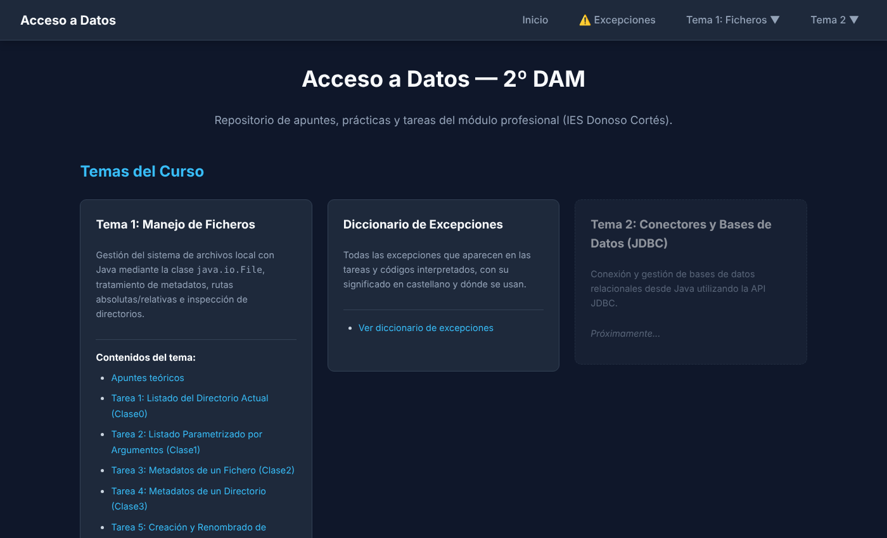
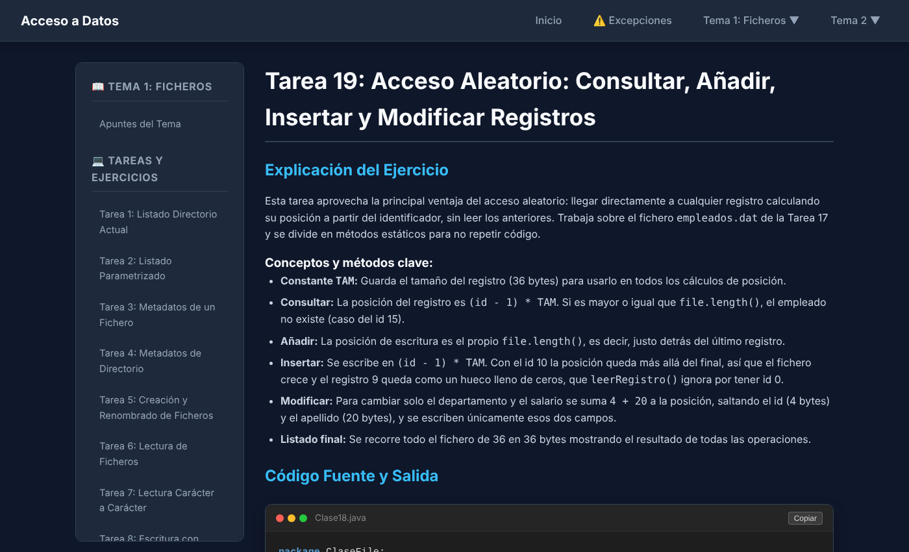
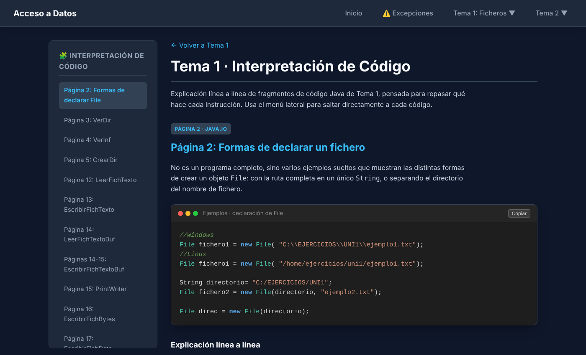
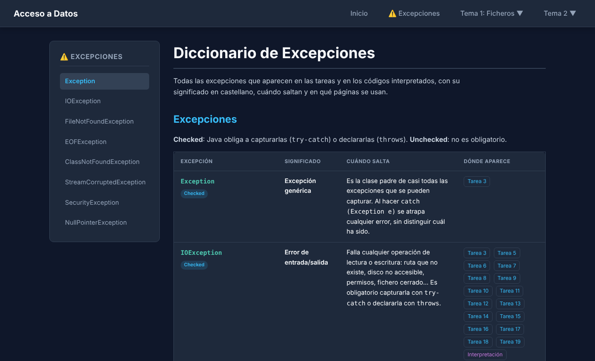
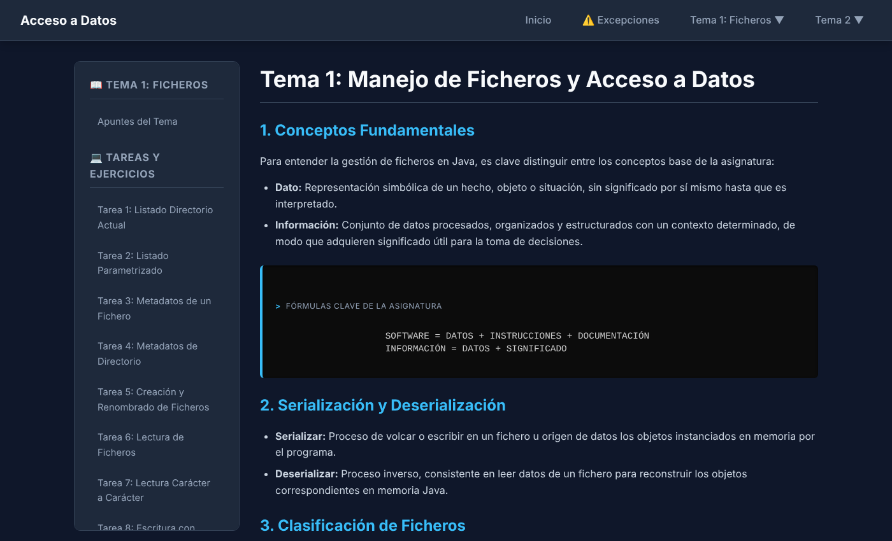

<div align="center">
  
</div>

<div align="center">
  <a href="https://github.com/evagr11/acceso-a-datos" target="_blank"></a>
  <a href="https://evagr11.github.io/acceso-a-datos/" target="_blank"></a>
</div>

<div align="center">
  <a href="https://git.io/typing-svg"></a>
</div>

# 🚀 Sobre el Proyecto

**Acceso a Datos** es mi cuaderno de la asignatura de 2º DAM convertido en web. En lugar de dejar los ejercicios sueltos en carpetas, cada tarea tiene su propia página con la explicación del ejercicio, los conceptos clave, el código fuente con resaltado de sintaxis y la salida por terminal, todo navegable desde un menú común.

<div align="center">
  
  <p><em>Portada con los temas del curso</em></p>
</div>

✨ **Características principales:**

*   📖 **Apuntes teóricos:** Resumen del Tema 1 (manejo de ficheros): conceptos base, serialización, clasificación de ficheros y metadatos.
*   💻 **19 tareas resueltas:** Desde listar un directorio con `File` hasta consultar, insertar y modificar registros con `RandomAccessFile`. Cada una explica el porqué del código, no solo el qué.
*   🧩 **Código interpretado línea a línea:** Los ejemplos del libro de la asignatura desmenuzados instrucción por instrucción, con un menú lateral para saltar entre ellos.
*   ⚠️ **Diccionario de excepciones:** Tabla con cada excepción que aparece (`IOException`, `EOFException`, `ClassNotFoundException`…), si es *checked* o *unchecked*, cuándo salta y en qué tareas se usa.
*   🖥️ **Bloques de código estilo VS Code:** Ventanas con resaltado de sintaxis y botón de **Copiar** en cada fragmento.
*   🧱 **Componentes reutilizables:** El navbar y los sidebars se escriben una sola vez en `includes/` y se inyectan con JavaScript en todas las páginas.

### Galería de Funcionalidades

| Página de una tarea | Código interpretado |
| :-----------------: | :-----------------: |
|  |  |
| *Explicación, conceptos clave, código y salida de cada tarea.* | *Ejemplos del libro explicados línea a línea.* |
| **Diccionario de excepciones** | **Apuntes del tema** |
|  |  |
| *Qué significa cada excepción y dónde aparece.* | *Teoría del tema con su propio menú lateral.* |

# 🧠 Contexto del Proyecto

Este repositorio forma parte de la asignatura **Acceso a Datos**, del segundo año del ciclo formativo de **Desarrollo de Aplicaciones Multiplataforma (DAM)** en el IES Donoso Cortés. Lo creé para repasar y entender de verdad lo que hago en clase: explicar cada tarea por escrito me obliga a saber qué hace cada línea, y tenerlo publicado como web me permite consultarlo desde cualquier sitio.

Es la continuación de [ADD-NDT](https://github.com/evagr11/ADD-NDT), donde documenté la primera etapa de la asignatura.

# 📚 Contenido por Temas

| Tema | Contenido | Estado |
| :--- | :-------- | :----: |
| **Tema 1: Manejo de Ficheros** | Apuntes · 19 tareas · Interpretación de código | ✅ |
| **Diccionario de Excepciones** | Excepciones de todas las tareas y códigos | ✅ |
| **Tema 2: Conectores y Bases de Datos (JDBC)** | — | 🔜 |

<details>
<summary><strong>Ver las 19 tareas del Tema 1</strong></summary>

<br>

| Tarea | Clase | Qué se practica |
| :---: | :---: | :-------------- |
| 1 | `Clase0` | Listado del directorio actual |
| 2 | `Clase1` | Listado parametrizado por argumentos |
| 3 | `Clase2` | Metadatos de un fichero |
| 4 | `Clase3` | Metadatos de un directorio |
| 5 | `Clase4` | Creación y renombrado de ficheros |
| 6 | `Clase5` | Lectura de ficheros con `BufferedReader` |
| 7 | `Clase6` | Lectura carácter a carácter con `FileReader` |
| 8 | `Clase7` | Escritura de texto con `FileWriter` |
| 9 | `Clase8` | Escritura con `BufferedWriter` |
| 10 | `Clase9` | Escritura con `PrintWriter` |
| 11 | `Clase10` | Escritura y lectura de bytes |
| 12 | `Clase11` | Escritura con `DataOutputStream` |
| 13 | `Clase12` | Lectura con `DataInputStream` |
| 14 | `Clase13` | Escritura de objetos con `ObjectOutputStream` |
| 15 | `Clase14` | Lectura de objetos con `ObjectInputStream` |
| 16 | `Clase15` | Añadir objetos a un fichero existente |
| 17 | `Clase16` | Acceso aleatorio: escritura |
| 18 | `Clase17` | Acceso aleatorio: lectura |
| 19 | `Clase18` | Acceso aleatorio: consultar, añadir, insertar y modificar |

</details>

# 🛠️ Stack Tecnológico

<div align="center">
  
  
  
  
  
  
</div>

<br>

<div align="center">

| Área | Tecnología |
| :--- | :--------- |
| **Contenido** | `Java` (`java.io`: `File`, flujos de texto y binarios, serialización, `RandomAccessFile`) |
| **Web** | `HTML5`, `CSS3` (variables y tema oscuro), `JavaScript` (Vanilla) |
| **Componentes** | `fetch` para inyectar navbar y sidebars desde `includes/` |
| **Despliegue** | `GitHub Pages` |

</div>

# 📂 Estructura del Proyecto

```bash
acceso-a-datos/
├── assets/
│   └── readme/                  # Capturas para este README
├── css/
│   ├── styles.css               # Estilos globales, tema oscuro y layout
│   ├── vscode-theme.css         # Ventanas de código estilo VS Code
│   ├── interpretacion.css       # Estilos de la interpretación de código
│   └── excepciones.css          # Estilos del diccionario de excepciones
├── includes/
│   ├── navbar.html              # Menú superior común
│   ├── sidebar-tema1.html       # Menú lateral de apuntes y tareas
│   ├── sidebar-interpretacion-tema1.html
│   └── sidebar-excepciones.html
├── js/
│   ├── components.js            # Carga navbar y sidebar en cada página
│   └── main.js                  # Botón copiar, scrollspy y scroll suave
├── temas/
│   ├── excepciones/
│   │   └── index.html           # Diccionario de excepciones
│   └── tema1/
│       ├── apuntes.html
│       ├── interpretacion-codigos.html
│       └── tarea1-clase0.html … tarea19-clase18.html
├── index.html                   # Portada con los temas del curso
└── README.md
```

> 💡 Cada página indica qué menú lateral necesita con el atributo `data-sidebar` (por ejemplo `data-sidebar="excepciones"`), y `components.js` calcula la ruta base para que los enlaces funcionen igual en local que en GitHub Pages.

# 🚀 Cómo Utilizar el Proyecto

### 1. Verlo online

La forma más rápida es abrir la web publicada: **[evagr11.github.io/acceso-a-datos](https://evagr11.github.io/acceso-a-datos/)**

### 2. Ejecución local

Como el navbar y los sidebars se cargan con `fetch`, el navegador bloquea esas peticiones si abres `index.html` con doble clic. Hay que servirlo con un servidor local:

1.  Clona el repositorio:
    ```bash
    git clone https://github.com/evagr11/acceso-a-datos.git
    ```
2.  Navega a la carpeta del proyecto:
    ```bash
    cd acceso-a-datos
    ```
3.  Levanta un servidor local con cualquiera de estas opciones:
    ```bash
    # Con Python
    python -m http.server 8000

    # O con la extensión Live Server de VS Code: clic derecho en index.html > Open with Live Server
    ```
4.  Abre `http://localhost:8000` en tu navegador.

<br>

<div align="center">
  <p>Creado por <strong>Eva Gallardo</strong></p>
  <a href="https://github.com/evagr11" target="_blank">
    
  </a>
  <a href="https://www.linkedin.com/in/eva-gallardo-romero-830362349/" target="_blank">
    
  </a>
</div>

<div align="center">
  
</div>
